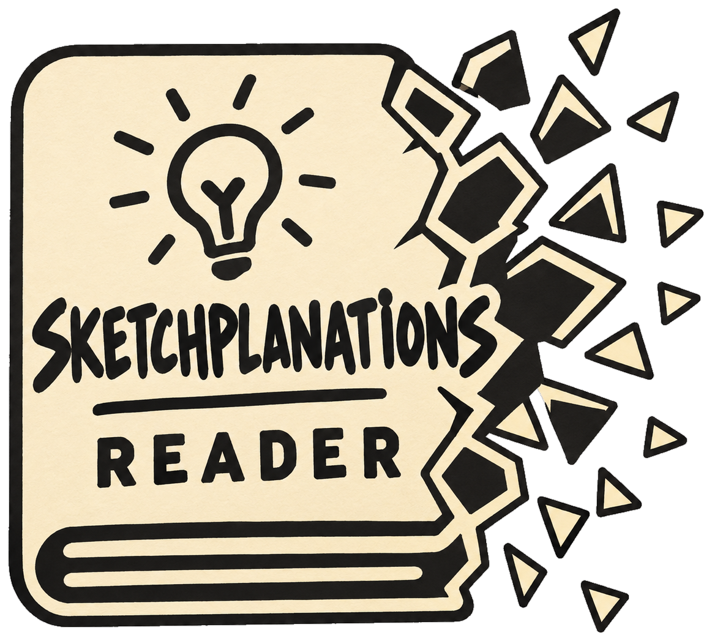

<p align="center"></p>

# Sketchplanations reader for Android

An unofficial, offline-first reader for [sketchplanations.com](https://sketchplanations.com) and its podcast.
Get the APK from [Releases](https://github.com/badjuice/sketchplanations-reader/releases).

## Build

```
git clone --recurse-submodules https://github.com/badjuice/sketchplanations-reader
./gradlew :app:assembleDebug
```

JDK 17+, Android SDK 34. Content comes through
[SketchplanationsExplode](https://github.com/badjuice/SketchplanationsExplode), a git submodule.

## Release

Commits follow [Conventional Commits](https://www.conventionalcommits.org); the changelog is generated from them.

```
npx git-cliff@2.6.1 --tag vX.Y.Z -o CHANGELOG.md
git commit -am "chore(release): X.Y.Z" && git tag -a vX.Y.Z -m "X.Y.Z"
./gradlew :app:assembleRelease && git push --follow-tags
gh release create vX.Y.Z app/build/outputs/apk/release/*.apk
```

The signing key is read from `~/.gradle/gradle.properties`, never the repo. Back it up: updates must use the same key.

## Licences

- App code: GPL-3.0, © 2026 [BadJuice](https://github.com/badjuice). Fonts: SIL OFL 1.1 (`licenses/fonts/`).
- Sketches and text: © Jono Hey, [CC BY-NC 4.0](https://sketchplanations.com/licence). Credit him, never sell.
- Podcast: © Sketchplanations - The Podcast. Streamed and downloaded from the public feed, never re-hosted.
- Scraped or downloaded content never goes in this repository.
